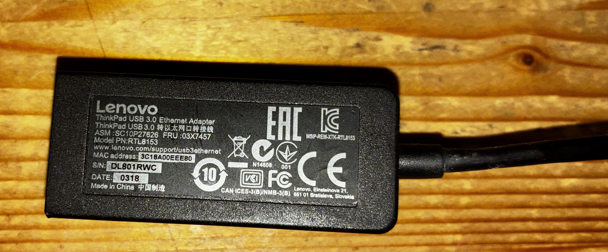
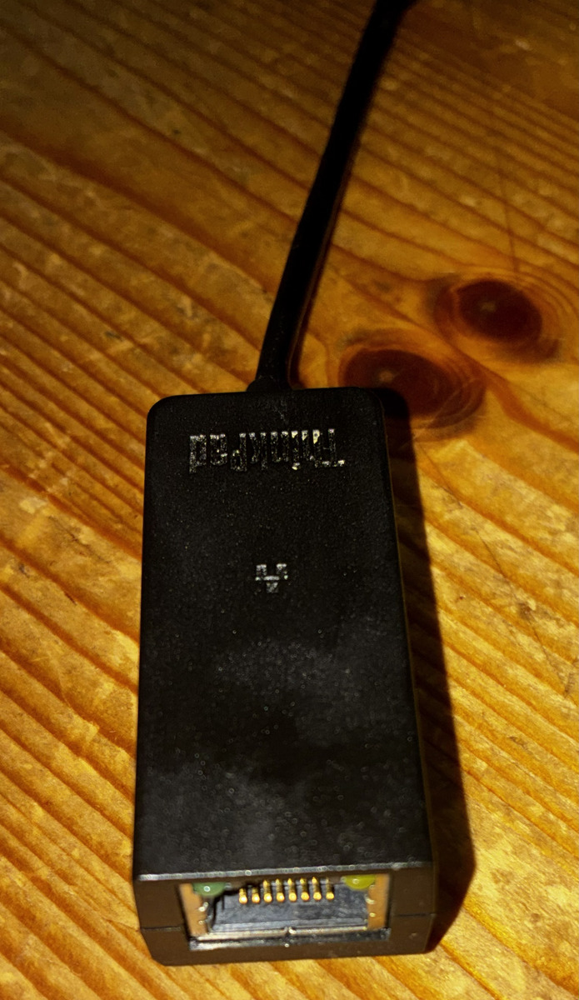
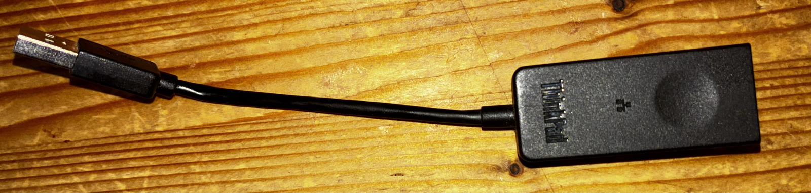

# nad 758 v3 amplifier wired ethernet

while i'm very content with the amplifier, it's networking options are disappointing. it comes with
what feels like a very flimsy external usb hub, a usb wifi and a usb bluetooth dongle. i have no
need for bluetooth and prefer wired over wireless. nad's documentation mentions only wireless is supported,
the bluos folks however claim on their fora that wired should also work with a supported adapter.
which adapters (or more correct: which usb to ethernet chipset) this would be was and is not clear to me.

## hardware and software versions

- upgraded with the vm 130i mdc module making it the same as a nad 758 v3i
- bluos controller 4.18.0 build 6613 windows version
- bluos player 4.16.6 on the nad

## wired usb ethernet

instead of trying to find the specific model mentioned in several forum posts from bluos i had
a look in the big box of dongles and the first one that came out was this lenovo one. i unplugged
the provided usb hub and plugged in the dongle directly into the receiver.

lo and behold, worked on the first try.

## works

- connects to the network just fine
- works with windows bluos controller via wired connection
- works with ios bluos controller that's connected via wifi
- can read/index music files on cifs/smb shares

## doesn't work

- upgrading the bluos on the player via the controller app.

## not tested

- all the rest
